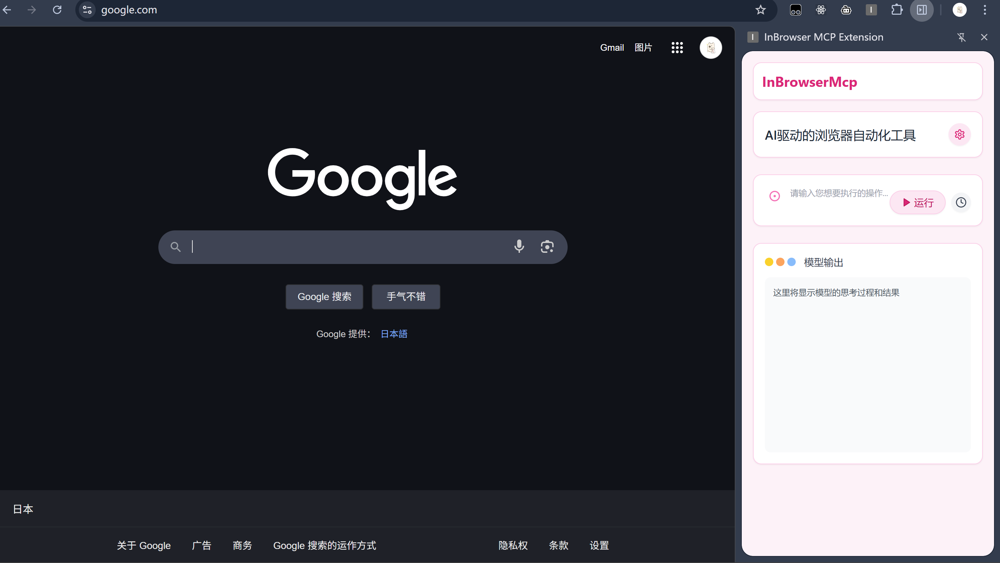
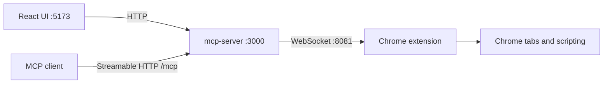

# InBrowserMcp

[](https://github.com/LofiSu/InBrowserMcp/actions/workflows/ci.yml)
[](LICENSE)
[](mcp-server/package.json)
[](https://www.typescriptlang.org/)
[](extension/manifest.json)

InBrowserMcp is an experimental [Model Context Protocol](https://modelcontextprotocol.io/) project that puts browser actions behind an MCP endpoint. A TypeScript server speaks Streamable HTTP, a Manifest V3 Chrome extension connects to that server over WebSocket, and a React page sends short commands that the server matches with keywords.



## What is in the repo

| Directory | Role |
| --- | --- |
| [`mcp-server`](mcp-server) | Express server. MCP Streamable HTTP on port **3000**, WebSocket for the extension on port **8081**. |
| [`extension`](extension) | Unpacked Chrome extension. `background.js` is the service worker that opens `ws://localhost:8081` and calls Chrome APIs. `content.js` is injected on all URLs. |
| [`frontend`](frontend) | React 19 + Vite + Tailwind UI. Talks to `http://localhost:3000`. |

There is no root `package.json`. Install and run each package from its own directory. Lockfiles are gitignored.



## HTTP and WebSocket

Defined in `mcp-server/src/server.ts` and `frontend/src/service/index.ts`:

| Endpoint | Method | Behavior in this repo |
| --- | --- | --- |
| `http://localhost:3000/mcp` | `POST` | MCP JSON-RPC. `Accept` must include both `application/json` and `text/event-stream`. `initialize` creates a session and returns `Mcp-Session-Id`. Later calls send that header. |
| `http://localhost:3000/mcp` | `GET` | Session event stream. Requires `Accept: text/event-stream` and a session id (header or `?sessionId=`). |
| `http://localhost:3000/mcp` | `DELETE` | Closes a session. Requires the session id. |
| `http://localhost:3000/api/ai-command` | `POST` | Body `{ command, sessionId, apiKey? }`. Keyword matcher, then a WebSocket message to the extension. |
| `http://localhost:3000/api/cancel-command` | `POST` | Body `{ sessionId }`. Rejects pending server-side WebSocket waits. |
| `ws://localhost:8081` | WebSocket | One extension connection. Messages are `{ type, payload, requestId }`. |

CORS allows origin `http://localhost:5173` only.

The server name registered with the MCP SDK is `Browser Plugin MCP Server`, version `1.0.0`.

## MCP tools the server registers

`createServer()` in `mcp-server/src/server.ts` registers these tools. Names and descriptions come from `mcp-server/src/types/tools.ts`.

| Name | Description |
| --- | --- |
| `navigate` | Navigate to a specified URL |
| `refreshPage` | Refresh the current active tab |
| `click` | Click on an element on the page |
| `hover` | Hover over an element on the page |
| `type` | Type text into an input element |
| `scroll` | Scroll the page up, down, left, right, or to a specific element |
| `get_content` | Get the HTML content of the page or a specific element |
| `get_attribute` | Get the value of a specific attribute for an element |
| `getCurrentState` | Get the URL and title of the current active tab |
| `execute_script` | Execute custom JavaScript code on the page |
| `getAllTabs` | Get information about all open tabs |
| `create_tab` | Create a new tab |
| `close_tab` | Close a specific tab |
| `focus_tab` | Focus on a specific tab |
| `getAllWindows` | Get information about all open browser windows |
| `createWindow` | Create a new browser window |
| `closeWindow` | Close a specific browser window |
| `focusWindow` | Focus on a specific browser window |
| `getCookies` | Get cookies for a specific URL |
| `setCookie` | Set a cookie |
| `deleteCookie` | Delete a cookie |
| `getStorageItem` | Get an item from local or session storage |
| `setStorageItem` | Set an item in local or session storage |
| `deleteStorageItem` | Delete an item from local or session storage |
| `searchHistory` | Search browser history |
| `deleteHistoryUrl` | Delete a specific URL from browser history |
| `createBookmark` | Create a new bookmark |
| `searchBookmarks` | Search bookmarks |
| `wait` | Wait for a specified duration (backend only) |
| `screenshot` | Take a screenshot of the current visible tab |
| `clearBrowsingData` | Clear browsing data |
| `snapshot` | Take a snapshot of the current page state (DOM/ARIA) |

Registration means an MCP client can list the tool. See [Wiring notes](#wiring-notes) before expecting every name to move the browser.

## Requirements

- Node.js 20 or newer (CI uses Node.js 22). The server's `@types/node` range is `^20`.
- npm. `pnpm` is only required for the `start` script, which is `pnpm build && node dist/server.js`.
- Google Chrome, to load the unpacked extension.

## Run it

Start the server before the extension so the WebSocket port is open. The extension retries every 5 seconds.

### 1. MCP server

```bash
cd mcp-server
npm install
npm run dev
```

`npm run dev` is `tsx watch src/server.ts`.

To compile and run the built file instead:

```bash
npm run build          # tsc, output in dist/
node dist/server.js
```

`npm start` shells out to pnpm (`pnpm build && node dist/server.js`). Use the two commands above when pnpm is not installed.

The process listens on `http://localhost:3000` and `ws://localhost:8081`.

### 2. Chrome extension

1. Open `chrome://extensions`.
2. Turn on Developer mode.
3. Choose **Load unpacked** and select the `extension` directory.
4. Keep the extension enabled. `background.js` connects to `ws://localhost:8081`.

`extension/manifest.json` (Manifest V3) requests `activeTab`, `scripting`, `storage`, `sidePanel`, and `tabs`. The side panel path is `dist/index.html` inside the extension directory. The Vite build writes to `frontend/dist`. No script copies that build into `extension/dist`.

### 3. React UI

```bash
cd frontend
npm install
npm run dev
```

Vite serves the app at `http://localhost:5173` (the default; `vite.config.ts` does not set a port). The page title in the UI is “AI驱动的浏览器自动化工具”.

Other scripts in `frontend/package.json`:

| Script | Command |
| --- | --- |
| `npm run lint` | `eslint .` |
| `npm run build` | `tsc -b && vite build` |
| `npm run preview` | `vite preview` |

`frontend` has no `test` script. The API base URL is the constant `http://localhost:3000` in `frontend/src/service/index.ts`.

On load, the UI `POST`s an MCP `initialize` request, then `notifications/initialized`, then opens `EventSource` on `GET /mcp?sessionId=...`. Typing a command and pressing Run calls `POST /api/ai-command`. Pressing the button again while a command is running calls `POST /api/cancel-command`. History shown in the clock dialog is React state for the current page session.

## Commands the keyword handler recognizes

`POST /api/ai-command` lowercases the text and picks one WebSocket `type`. It does this with `String.includes` checks in `server.ts`. `apiKey` is accepted on the body and unused.

| When the command text includes | WebSocket `type` | Payload |
| --- | --- | --- |
| `bilibili`, `搜索框`, and `输入` | `typeText` | `{ selector: "#nav-search-input", text, options: { delay: 50 } }`. `text` is the substring after `输入`, or `Trae AI`. |
| `导航到` or `打开` | `navigate` | `{ url }`. The word after `打开` is used as the host, with `https://` added when it does not already start with `http`. If that word is missing and the text mentions bilibili, the URL is `https://www.bilibili.com`. Otherwise it is `https://www.google.com`. |
| `点击` or `单击` | `click` | `{ selector }`. A quoted value after `选择器` or `selector` is used. Otherwise the selector is `button`. |
| `快照`, `截图`, or `页面状态` | `snapshot` | `{}` |
| anything else | `getConsoleLogs` | `{}` |

`background.js` handles `navigate` and `click`. It has no `typeText`, `snapshot`, or `getConsoleLogs` branch. The extension's typing branch is named `type`.

The gear icon opens a modal whose textarea lives in component state. The 保存 button has no click handler.

## Manual MCP client

`mcp-server` `npm test` runs `tsx src/test/test-client.ts`. That file is a demo client: it connects to `http://localhost:3000/mcp`, lists tools, and calls `navigate` and `snapshot`. Start the server first. It is not a unit-test suite, and CI does not run it.

`callTool` arguments follow the installed SDK: `{ name, arguments }`.

## Wiring notes

These are behaviors of the current source, useful if a tool call seems to do nothing.

- Tool handlers follow `Context.sendBrowserAction(type, payload)` from `mcp-server/src/types/context.ts` and call it with two arguments, for example `sendBrowserAction("navigate", { url })`. The function implemented in `server.ts` is `sendBrowserAction(sessionId, type, payload)` and puts the second argument in the WebSocket `type` field. `/api/ai-command` calls the three-argument form, so the UI path and the MCP tool path do not send the same message shape.
- Several tool handlers send camelCase names (`refreshPage`, `hover`, `getCurrentState`, `getCookies`, `getStorageItem`, `searchHistory`, `createBookmark`, `clearBrowsingData`, `getAllTabs`, `createWindow`, …). The extension switch uses different strings for those actions (`refresh_page`, `hover_element`, `get_current_state`, `get_cookies`, `get_storage`, `search_history`, `create_bookmark`, `clear_browsing_data`, `get_all_tabs`, `create_window`, …). Names that already match a `case` include `navigate`, `click`, `type`, `scroll`, `get_content`, `get_attribute`, `execute_script`, `screenshot`, `create_tab`, `close_tab`, and `focus_tab`.
- `getBrowserState()` rejects with `getBrowserState via WebSocket not implemented yet.` `captureAriaSnapshot` calls it and also sends a `snapshot` WebSocket message. `background.js` has no `snapshot` branch.
- `background.js` also calls `chrome.cookies`, `chrome.history`, `chrome.bookmarks`, `chrome.browsingData`, and `chrome.windows`. The manifest does not declare those permissions, and it declares no `host_permissions`.
- `/api/cancel-command` logs `sessionId` and rejects every entry in the server's pending-request map. It does not send a cancel message to the extension, so a navigation already started in Chrome keeps going.
- `npm test`'s client can list tools only while the HTTP server is up. Tool calls still depend on the WebSocket bridge above.

## 中文简介

InBrowserMcp 是一个实验项目：TypeScript MCP 服务通过 WebSocket 驱动 Chrome 扩展，并附带一个 React 页面。页面里的指令由服务端按关键词匹配后转发，当前实现里没有调用语言模型。

- HTTP / MCP：`http://localhost:3000`（`/mcp` 支持 `POST`、`GET`、`DELETE`）
- WebSocket：`ws://localhost:8081`（扩展在 `extension/background.js` 里连接）
- 前端：在 `frontend` 目录执行 `npm install` 和 `npm run dev`，默认 `http://localhost:5173`
- 扩展：在 `chrome://extensions` 加载未打包的 `extension` 目录

安装顺序、脚本和工具列表以上面的英文说明为准。旧文档里的 `8080` 端口是错的，HTTP 端口以 `mcp-server/src/server.ts` 里的 `PORT = 3000` 为准。

## Contributing

See [CONTRIBUTING.md](CONTRIBUTING.md). Suggested GitHub About text and topics are in [REPO_META.md](REPO_META.md).

## License

[MIT](LICENSE). Copyright (c) 2025-2026 LofiSu.
