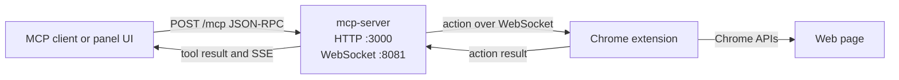

# InBrowserMcp

[](https://github.com/LofiSu/InBrowserMcp/actions/workflows/ci.yml)
[](LICENSE)

**Status: experimental.** APIs, permissions, and the natural-language command path are still changing.

**Let AI agents drive Chrome through the Model Context Protocol.**

InBrowserMcp is a Chrome extension, a local MCP server, and a small React panel. An MCP client calls tools such as navigate, click, type, and snapshot. The server forwards each call to the extension over WebSocket, and the extension runs it with Chrome APIs.


There is no demo GIF in the repo yet. The screenshot above is the panel UI (side-panel chrome around the same React app).

## Features

- MCP server over [streamable HTTP](https://modelcontextprotocol.io/) at `http://localhost:3000/mcp`, built with `@modelcontextprotocol/sdk`.
- Chrome extension (`extension/`) that connects to `ws://localhost:8081` and performs the browser action.
- Tools for navigation, clicks, typing, scrolling, page content, tabs, windows, screenshots, and an ARIA snapshot.
- A React + Vite panel for sending a command and watching session events. During development it runs at `http://localhost:5173`.

## Architecture



| Piece | Role |
| --- | --- |
| [`mcp-server`](mcp-server/README.md) | Express + TypeScript MCP server. Registers tools, holds the MCP session, and bridges tool calls to the extension. |
| [`extension`](extension/README.md) | Manifest V3 service worker. One WebSocket to the server. Executes commands with Chrome extension APIs and content scripts. |
| [`frontend`](frontend/README.md) | React UI. Opens an MCP session, posts commands to `/api/ai-command`, and listens on `/mcp` for events. |

The panel's natural-language route is a stand-in. `/api/ai-command` does not call a model yet. Real agent use goes through the MCP endpoint: your client (Cursor, Claude, or anything that speaks streamable HTTP) chooses the tool.

## Quick start

You need Node.js 18 or newer, npm, and Google Chrome.

```bash
git clone https://github.com/LofiSu/InBrowserMcp.git
cd InBrowserMcp
```

**1. Start the MCP server** (HTTP `http://localhost:3000`, WebSocket `ws://localhost:8081`):

```bash
cd mcp-server
npm install
npm run dev
```

`npm run dev` watches TypeScript. To run the compiled server instead, use `npm start` (it builds with `tsc`, then runs `node dist/server.js`).

**2. Load the extension**

1. Open `chrome://extensions`.
2. Turn on Developer mode.
3. Choose **Load unpacked** and select the `extension` directory.
4. Keep the extension enabled. Its service worker connects to `ws://localhost:8081` on its own.

**3. Start the panel** (optional if you only use an external MCP client):

```bash
cd frontend
npm install
npm run dev
```

Open `http://localhost:5173`. The server CORS allow-list is that origin only.

`extension/manifest.json` also declares a Chrome side panel at `dist/index.html`. That file is not produced by the current Vite build: `npm run build` writes `frontend/dist` with absolute asset URLs, which an extension page cannot load. Use the Vite dev server until a relative-base build is wired up.

## Connect an MCP client

Run the server and the extension first. Point the client at:

```text
http://localhost:3000/mcp
```

Example for clients that take a remote MCP URL:

```json
{
  "mcpServers": {
    "inbrowser": {
      "url": "http://localhost:3000/mcp"
    }
  }
}
```

`POST /mcp` must send `Accept: application/json, text/event-stream`. The first call is `initialize`; the server returns `Mcp-Session-Id`. See `frontend/src/service/index.ts` for a working handshake.

`cd mcp-server && npm test` is a small live client (`src/test/test-client.ts`) that lists tools and calls `navigate` plus `snapshot`. It needs the server, and navigation also needs the extension. CI does not run it.

## MCP tools

Names and descriptions come from `mcp-server/src/types/tools.ts`. Arguments are validated with Zod. After a navigation-style action, several tools also try to return an ARIA snapshot.

| Tool | Description |
| --- | --- |
| **Navigation** | |
| `navigate` | Navigate to a URL. |
| `refreshPage` | Refresh the current active tab. |
| **Interaction** | |
| `click` | Click an element (`selector`). |
| `hover` | Hover an element (`selector`). |
| `type` | Type `text` into an element (`selector`). |
| `scroll` | Scroll by `direction` (`up`, `down`, `left`, `right`) or to a `selector`. Optional pixel `amount`. |
| **Page content** | |
| `get_content` | HTML of the page, or of `selector` when set. |
| `get_attribute` | One attribute of an element. |
| `getCurrentState` | URL and title of the active tab. |
| **Snapshot** | |
| `snapshot` | DOM / ARIA snapshot of the current page. |
| **Tabs** | |
| `getAllTabs` | List open tabs. |
| `create_tab` | Open a tab. Optional `url` and `active`. |
| `close_tab` | Close a tab by `tabId`. |
| `focus_tab` | Focus a tab by `tabId`. |
| **Windows** | |
| `getAllWindows` | List browser windows. |
| `createWindow` | Open a window. Optional `url`, `focused`, and `type` (`normal`, `popup`, `panel`). |
| `closeWindow` | Close a window by `windowId`. |
| `focusWindow` | Focus a window by `windowId`. |
| **Storage** | |
| `getCookies` | Cookies, optionally filtered by `url`, `name`, `domain`, or `path`. |
| `setCookie` | Set a cookie (`url`, `name`, `value`, plus usual cookie flags). |
| `deleteCookie` | Delete a cookie by `url` and `name`. |
| `getStorageItem` | Read `local` or `session` storage. |
| `setStorageItem` | Write `local` or `session` storage. |
| `deleteStorageItem` | Delete a storage key. |
| **History and bookmarks** | |
| `searchHistory` | Search history (`text`, optional time range and `maxResults`). |
| `deleteHistoryUrl` | Delete one history URL. |
| `createBookmark` | Create a bookmark (`url`, optional `title` and `parentId`). |
| `searchBookmarks` | Search bookmarks by `query`. |
| **Other** | |
| `screenshot` | Screenshot of the visible tab. |
| `wait` | Wait on the server for `time` milliseconds. Does not block the page. |
| `execute_script` | Run a JavaScript string in the page. |
| `clearBrowsingData` | Clear selected browsing-data types since an optional timestamp. |

## Project layout

```text
InBrowserMcp/
├── extension/          # Chrome extension (manifest, service worker, content script)
├── mcp-server/         # MCP server and tool implementations
├── frontend/           # React panel
├── assets/image.png    # Panel screenshot
├── CONTRIBUTING.md
└── LICENSE             # MIT
```

## Status

This is a working sketch, not a packaged product.

- One extension WebSocket. A second connection replaces the first.
- HTTP `:3000` and WebSocket `:8081` are hard-coded in `mcp-server/src/server.ts`. The panel's API base URL is hard-coded in `frontend/src/service/index.ts`.
- `extension/manifest.json` currently requests `activeTab`, `scripting`, `storage`, `sidePanel`, and `tabs`. History, bookmarks, cookies, and browsing-data tools are implemented in the server and the service worker, but those Chrome permissions are not in the manifest yet, so those calls fail until the manifest (and the user consent prompt) includes them.
- `/api/ai-command` does not call an LLM. It is the panel's command hook, not the MCP tool path.
- `execute_script` runs caller-supplied JavaScript in the page. Treat any exposed server as local and trusted.
- No demo GIF is checked in. PRs that add a short recording under `assets/` are welcome.

## Repository topics

GitHub topics are not stored in the repo. Maintainers should set:

`mcp` `chrome-extension` `browser-automation` `typescript` `ai-agents`

The suggested About description, the exact `gh repo edit` command, and how the license field is detected are in [CONTRIBUTING.md](CONTRIBUTING.md).

## Contributing

Issues and pull requests are welcome in Chinese or English. See [CONTRIBUTING.md](CONTRIBUTING.md). CI typechecks and builds `mcp-server` and `frontend` on Node.js 22.

## License

[MIT](LICENSE). Copyright (c) 2025 LofiSu.

## 中文

**一句话：** 用 MCP 让 AI 驱动 Chrome，在页面里导航、点击、输入并读取内容。

InBrowserMcp 仍处于实验阶段。它由三部分组成：Chrome 扩展、本地 MCP 服务（`mcp-server`），以及一个 React 面板（`frontend`）。MCP 客户端通过 `http://localhost:3000/mcp` 调用工具；服务端经 `ws://localhost:8081` 把动作交给扩展；扩展再用 Chrome API 在浏览器里执行，并把结果返回。

面板里的自然语言入口（`/api/ai-command`）目前只是占位，不会调用大模型。真正给 Agent 用的是 MCP 端点。

### 快速开始

需要 Node.js 18+、npm 和 Chrome。

```bash
git clone https://github.com/LofiSu/InBrowserMcp.git
cd InBrowserMcp

cd mcp-server
npm install
npm run dev
```

另开一个终端：

```bash
cd frontend
npm install
npm run dev
```

在 `chrome://extensions` 打开开发者模式，选择「加载已解压的扩展程序」，指向仓库里的 `extension` 目录。扩展会自己连接 `ws://localhost:8081`。面板地址是 `http://localhost:5173`（服务端 CORS 只放行这个来源）。HTTP 端口是 **3000**，不是 8080。

把 MCP 客户端指到 `http://localhost:3000/mcp`。工具名称、参数和限制见上方英文的 MCP tools 与 Status。架构、权限缺口和侧栏构建方式也以英文部分为准。

### 参与

欢迎用中文提 Issue 或 Pull Request，说明见 [CONTRIBUTING.md](CONTRIBUTING.md)。许可证为 [MIT](LICENSE)。

仓库 About 仍为空时，建议描述为：Experimental MCP server and Chrome extension that lets AI agents drive the browser. 建议 Topics：`mcp`、`chrome-extension`、`browser-automation`、`typescript`、`ai-agents`。这些要在 GitHub 仓库设置里填写，不能靠本仓库里的文件生效。
